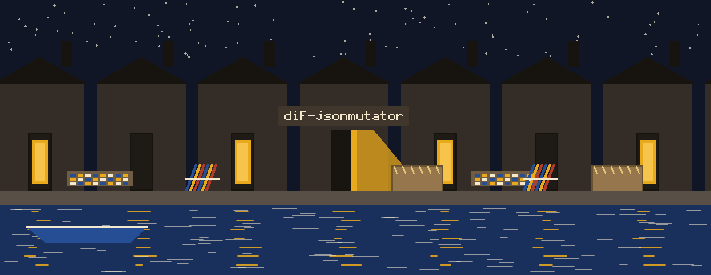

# dif-JSONMutator

Title block: the name above is set in Braah One in kohl black on papyrus, with a gold rule beneath it and one small furnace door marker beside the first heading only, in the manner of a painted lintel over a furnace house door.

A command-line tool that takes a JSON schema and a JSON sample as input, and generates a stream of mutated JSON payloads based on the schema. Uses a combination of random value generation within type constraints and guided mutations based on common JSON vulnerabilities (e.g., integer overflows, string injections). - Focused on Dynamically generates and injects fuzzed input into running applications (e.g., web applications, APIs). Focuses on identifying vulnerabilities by observing application behavior under unexpected input conditions. Supports various fuzzing strategies, such as mutation-based and generation-based fuzzing.

> Ledger margin note: the program delivers payloads nowhere. It generates text and writes text, to a file when asked and to the terminal when not. No running program receives them, no address is contacted, and no injection is performed by this code. The wider claim in the description above stands as printed in the live record, and it is answered on the website, not airbrushed out of this page.

## Install
`git clone https://github.com/ShadowGuard-AI/dif-jsonmutator`

## Usage
`python3 main.py --schema SCHEMA.json --sample SAMPLE.json`

> Ledger margin note: iterations below one are refused. A count under 1 ends the run with exit 1 before any payload is made, a floor the live record never mentions.

## Parameters
- `-h`: Show help message and exit
- `--schema`: Path to the JSON schema file (required).
- `--sample`: Path to the JSON sample file (required).
- `--iterations`: Number of mutated payloads to generate (default: 1).
- `--output`: Path to the output file to write the mutated payloads. If not specified, outputs to stdout.

> Ledger margin note: infinity and not a number break strict parsers, deliberately. Fractional strategies can set those values, and the output writes them in the extended spellings Python accepts, which strict JSON parsers reject. That is fuzz output by design, and it needs knowing before the first run.

> Ledger margin note: no seed exists, so saved output is the only record. Nothing seeds the random choice anywhere in the program and no seed option exists, so the same schema and sample produce different payloads on every run, and a payload worth keeping survives only if its output was saved.

## License
Licensed under the terms in LICENSE.

## Night notes, gathered at the back of the ledger

The buttons of this re-skin read Fire a Batch, Ledger the Payloads, and Read the Night Notes. Its headings read Nothing Is Delivered For You, Standard Library Only, Length Never Changes, Not Finite, On Purpose, and No Seed, No Second Chance. Facts entered once more at full size: nothing outside the Python standard library is imported, and the requirements file is a comment saying exactly that. An array keeps its length exactly, its items mutated one for one, and an empty array stays empty. The repository LICENSE file carries the MIT License, its holder line joining the public pen name to a shortened form in parentheses and the account handle, the shortened form left exactly as found.
